# EM Verification Results

Verification results from experiment runs on the OPS-SAT Engineering Model (EM), ARM32 dual-core SEPP. See [TESTING.md](../TESTING.md) for the test environment. On-orbit flight results live separately in [`flight/`](../flight/).

For previous EM results, see [V3_TO_V4.md](V3_TO_V4.md) (v4) and [V2_TO_V3.md](V2_TO_V3.md) (v3). For the v5 changes, see [V4_TO_V5.md](V4_TO_V5.md). For the v6 changes (postcard scatter fix, flight run script), see [V5_TO_V6.md](V5_TO_V6.md). For the v7 changes (narrowing stage, second-stage filtering removal, sc16 replay input), see [V6_TO_V7.md](V6_TO_V7.md). For the v8 changes (detection-conditional sc16 retention), see [V7_TO_V8.md](V7_TO_V8.md). For the distress detection package on v8, see [V8_TO_V8_DISTRESS_V1.md](V8_TO_V8_DISTRESS_V1.md).

## Distress v1 Verification

One EM session via SMILE on the self-contained package `exp4023-pretty-DOOMed-v8-distress-v1.tar.gz` (see [V8_TO_V8_DISTRESS_V1.md](V8_TO_V8_DISTRESS_V1.md)), on the shipped `run.cfg`: all five models on the two shortest clips. The purpose of the session is the execution times on the EM hardware. The SDR was not used.

### Session 1 (clean pass)

Data from SMILE artifact [`pack-flatsat-4023_1795030341`](data/em-v8-distress-v1/pack-flatsat-4023_1795030341/): the downlinked `distress-00001/` directory, the systemd journal of the run (`journal.log`), and the scored results (`results/`).

| Model | Exit | Run time | Model load | STT time | RTF | Peak memory (VmHWM) | Mayday detected |
|---|---|---|---|---|---|---|---|
| `zipformer-small-int8` | 0 | 35 s | 18.4 s | 14.7 s | 1.68 | 119 MiB | 2/2 |
| `parakeet-110m-int8` | 0 | 35 s | 17.1 s | 16.4 s | 1.87 | 207 MiB | 2/2 |
| `parakeet-0.6b-v2-int8-w5` | 0 | 111 s | 44.5 s | 64.3 s | 7.35 | 729 MiB | 2/2 |
| `parakeet-0.6b-v2-int8` | 0 | 112 s | 45.6 s | 64.1 s | 7.32 | 729 MiB | 2/2 |
| `parakeet-0.6b-v2-int8-t2` | 0 | 89 s | 47.4 s | 40.0 s | 4.58 | 729 MiB | 2/2 |

The three Parakeet 0.6B v2 runs use the same model file. `parakeet-0.6b-v2-int8` cuts the audio into 10 s windows and uses one CPU core. `-w5` cuts the audio into 5 s windows, which needs less memory. `-t2` uses 10 s windows and both CPU cores. Both clips of this test are shorter than 5 s, so each clip is one window with either window length, and `-w5` does the same work as the 10 s config. Each model loads once, before its first clip.

| Model | Clip | Length | STT time | RTF | Mayday detected | Transcript on board |
|---|---|---|---|---|---|---|
| `zipformer-small-int8` | `37977-bainbridge-skiff` | 4.4 s | 7.4 s | 1.67 | Yes | MAY DAY MAY DAY MAY DAY |
| `zipformer-small-int8` | `56367-netarts-pwc` | 4.3 s | 7.3 s | 1.69 | Yes | MAY DAY MAY DAY MAY DAY JETS HERE DOWN |
| `parakeet-110m-int8` | `37977-bainbridge-skiff` | 4.4 s | 8.3 s | 1.86 | Yes | Mayday, mayday May day. |
| `parakeet-110m-int8` | `56367-netarts-pwc` | 4.3 s | 8.1 s | 1.88 | Yes | Mayday Mayday May get down. |
| `parakeet-0.6b-v2-int8-w5` | `37977-bainbridge-skiff` | 4.4 s | 32.4 s | 7.30 | Yes | Mayday, Mayday, Mayday. |
| `parakeet-0.6b-v2-int8-w5` | `56367-netarts-pwc` | 4.3 s | 31.9 s | 7.39 | Yes | Mayday, meday, melee. Shut skier down. |
| `parakeet-0.6b-v2-int8` | `37977-bainbridge-skiff` | 4.4 s | 32.3 s | 7.28 | Yes | Mayday, Mayday, Mayday. |
| `parakeet-0.6b-v2-int8` | `56367-netarts-pwc` | 4.3 s | 31.7 s | 7.36 | Yes | Mayday, meday, melee. Shut skier down. |
| `parakeet-0.6b-v2-int8-t2` | `37977-bainbridge-skiff` | 4.4 s | 19.6 s | 4.42 | Yes | Mayday, Mayday, Mayday. |
| `parakeet-0.6b-v2-int8-t2` | `56367-netarts-pwc` | 4.3 s | 20.4 s | 4.73 | Yes | Mayday, meday, melee. Shut skier down. |

The session ran on 2026-11-19 and took 7 min 10 s. The EM clock read 2026-11-18 19:25:11 to 19:32:21 UTC, and the timestamps in the logs, in `manifest.txt`, and on the report cards come from this clock. All five models exited 0 and detected a distress phrase in both clips. Zipformer writes "MAY DAY" as two words, which the detector also matches. The ten transcripts are byte-identical to the transcripts of the last emulator run, and the ship-side WER and recall are the same as on the ground binary. No warnings or errors in the logs.

MemAvailable at the start was 967 MiB (MemTotal 1003 MiB). Parakeet 0.6B v2 peaked at 729 MiB, so the margin was 238 MiB and the lowest free memory during the run was 256 MiB. The emulator peaks (768 MiB to 869 MiB, QEMU included) were conservative. Each model was released before the next one started, so no two models were in memory at the same time.

The model load is the slowest part on the EM: 17 s to 47 s, 2.4 to 3.7 times slower than on the emulator, and 40 % of the run time of Parakeet 0.6B v2 on these short clips. With one thread, the transcription speed of Parakeet 0.6B v2 is the same as on the emulator (RTF 7.3), and the 5 s windows are not slower than the 10 s windows. Two threads make it 1.6 times faster (RTF 4.6). No model is real time on the EM: the fastest, Zipformer small, has an RTF of 1.68. The first model started 48 s after the start of the run, because the run script computes the SHA-256 of the models for the manifest.

The ten report cards were drawn on board, approximately 1 s each, by a second thread on the other CPU while the main thread transcribed the next clip.

With these RTFs, the 830 s of audio of all 13 clips give a full run of approximately 5.3 h: 24 min for Zipformer small, 26 min for Parakeet 110M, 102 min for each one-thread Parakeet 0.6B v2 model, and 64 min for the two-thread model. This is an estimate from two 4 s clips.

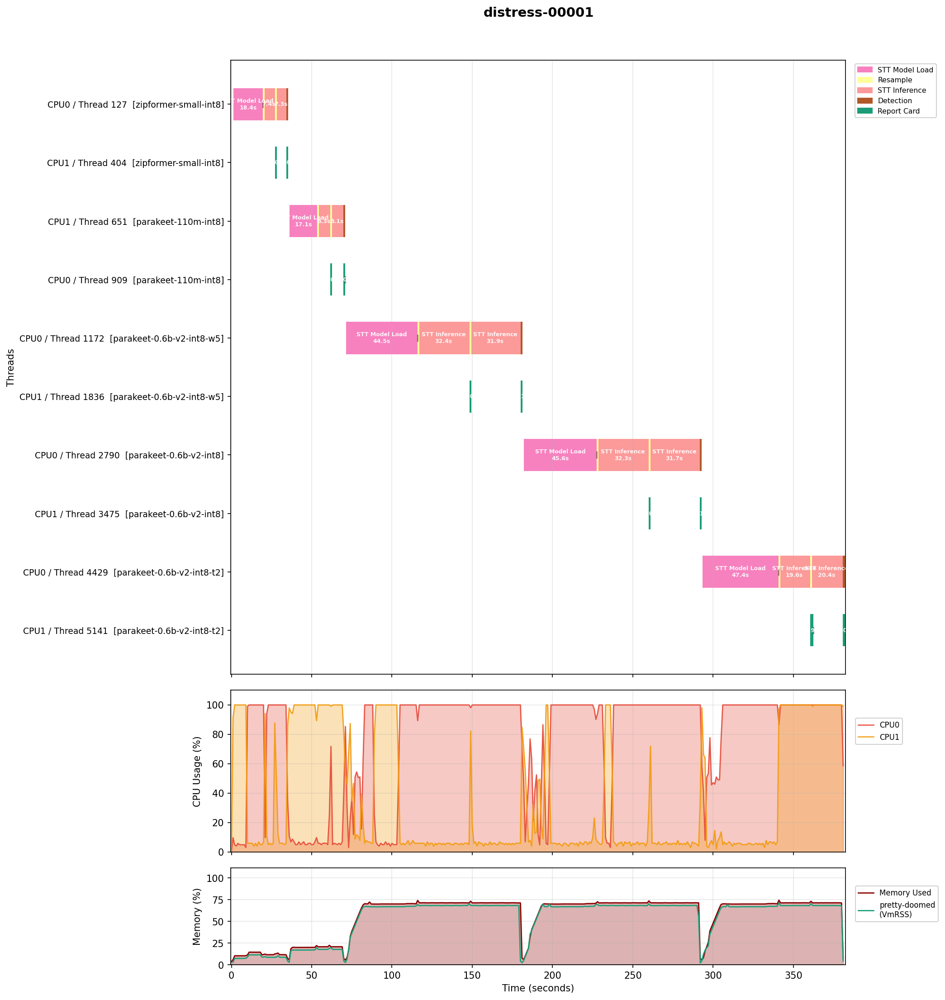

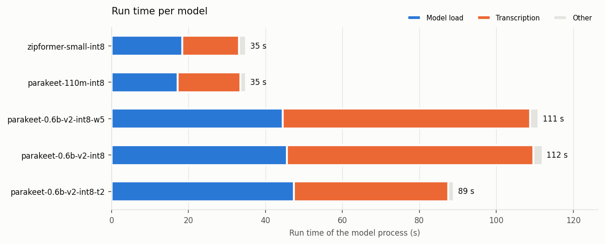

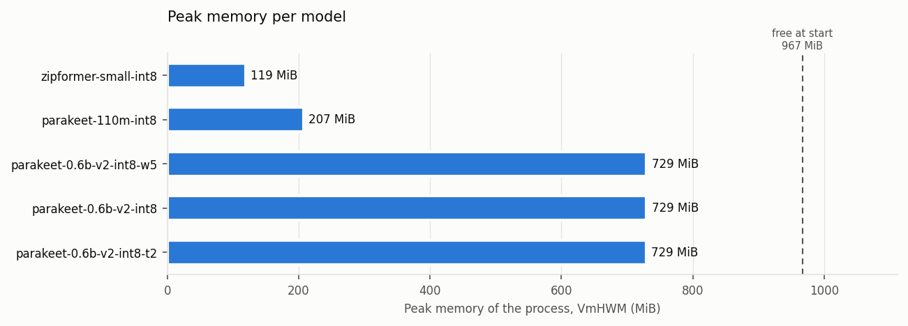

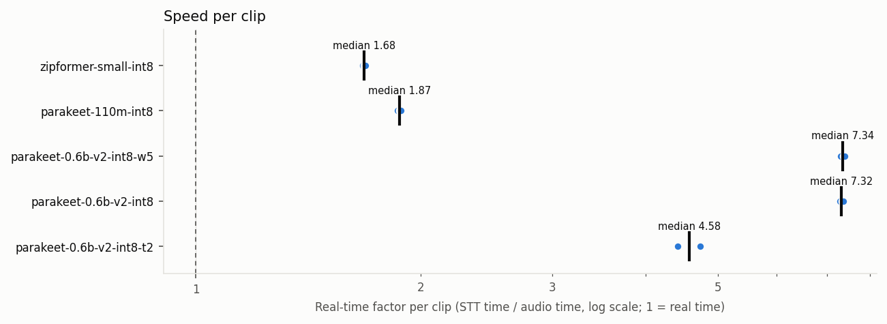

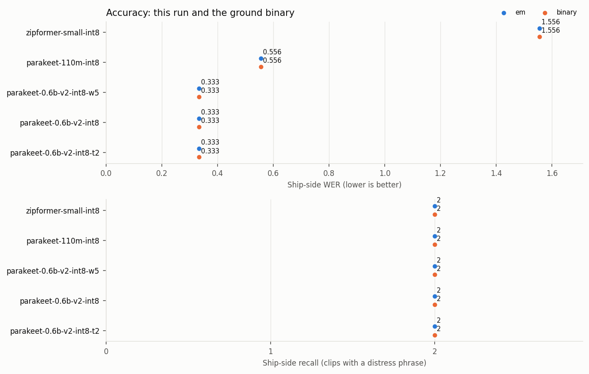

Report cards made on board:

| Model | `37977-bainbridge-skiff` | `56367-netarts-pwc` |
|---|---|---|
| `zipformer-small-int8` | 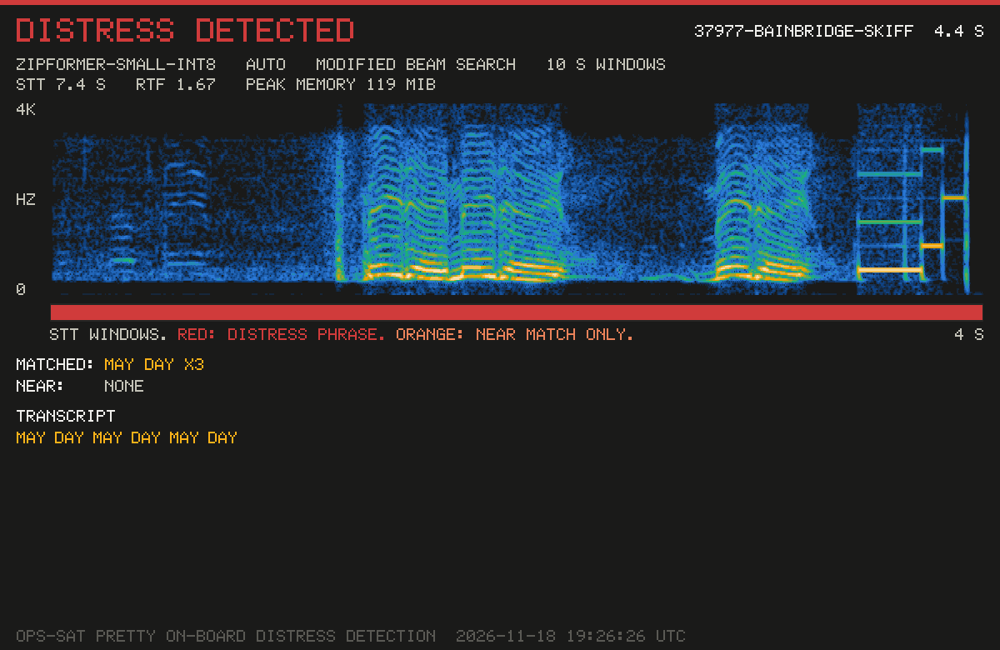 | 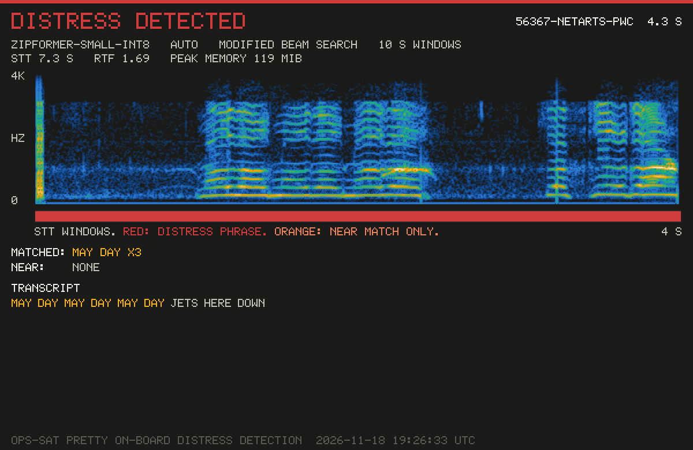 |
| `parakeet-110m-int8` |  | 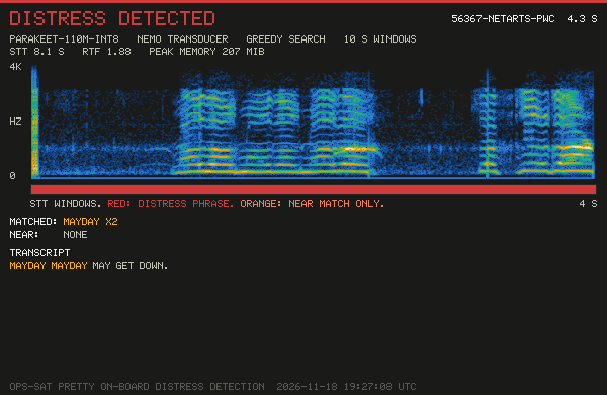 |
| `parakeet-0.6b-v2-int8-w5` | 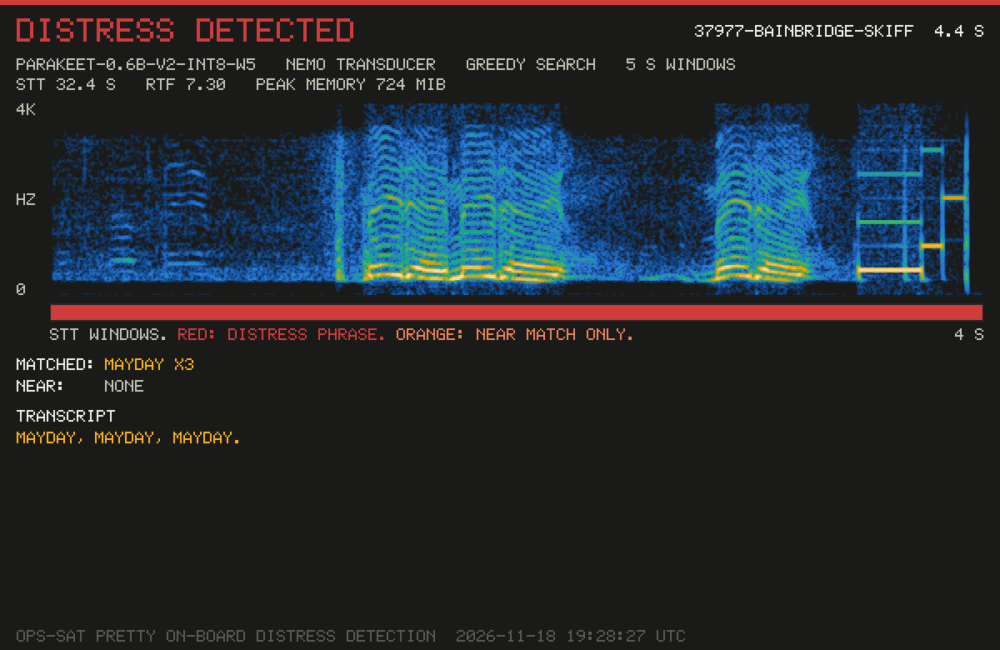 | 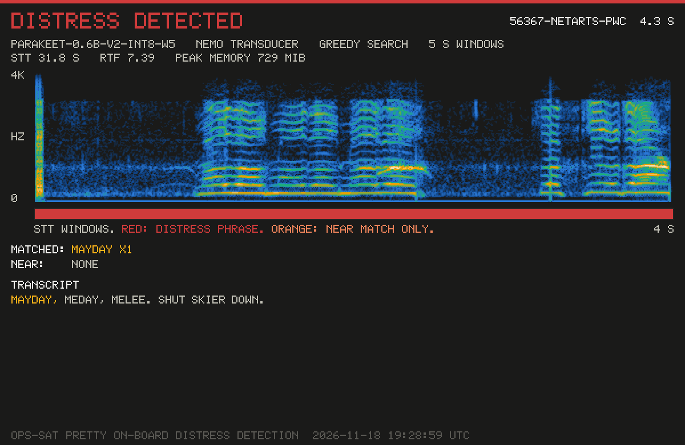 |
| `parakeet-0.6b-v2-int8` |  |  |
| `parakeet-0.6b-v2-int8-t2` |  | 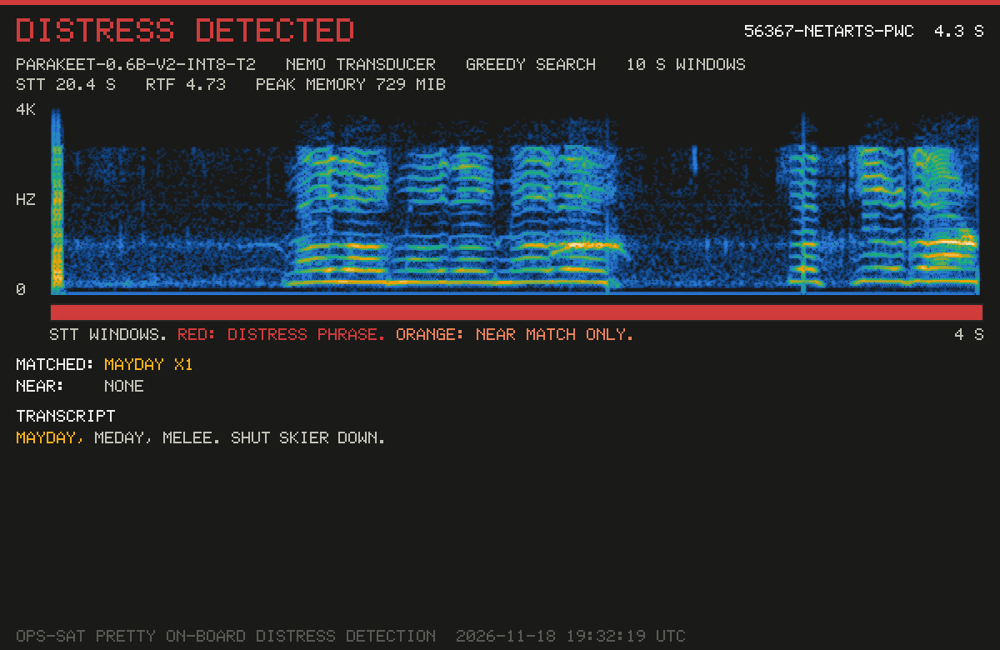 |

### Verdict

**The distress package runs on the EM.** All five models, Parakeet 0.6B v2 included, fit in the EM memory with a margin of 238 MiB, and they give the same transcripts as the emulator and the ground binary. The next step is the same package with all 13 clips (`clips=` empty in `run.cfg`), approximately 5.3 h.

## v8 Verification

Two live-SDR sessions on the EM via SMILE, both on the `exp4023-pretty-DOOMed-v7-to-v8.tar.gz` patch (`pretty-doomed`, `VERSION`, `config.cfg`) extracted over the v7 installation, with the SDR on and nothing transmitted, on the as-shipped flight configuration (`sdr_keep_sc16=detected`, `doom_force_trigger=false`, narrowing armed, hardware FIR, 6 captures).

### Session 1 (aborted)

Data from SMILE artifact [`pack-flatsat-4023_1786988477`](data/em-v8/pack-flatsat-4023_1786988477/). The v8 banner confirms the patched binary and config ran. Capture 1 completed at full sample counts (4,000,000/4,000,000 I/Q, 320,000/320,000 audio, 20.6 s wall), narrowing ran (peak at +19.29 kHz, EM background), the transcription produced noise fragments (`AND YET`), no command was detected, and the retention policy deleted the raw I/Q: `SC16 deleted` logged after all artifact consumers finished, with the spectrogram, constellation, PSD, and metrics all present in the pack and no `capture.sc16`. The first on-hardware verification of the detected-mode delete path.

The session then ended during capture 2: I/Q delivery stalled at 3,283,171 of 4,000,000 samples (~16.4 s of data) and stayed frozen for 30 s, the 50 s timeout fired, `tb->wait()` hung for 10 s, and the app force-exited, so captures 3 to 6 never ran. Capture 2's directory holds a partial 16.3 s `capture.sc16` and a truncated `capture.wav`, left behind by the abort rather than by the retention policy. The pack also carried zero-byte `transcription.txt`, `scores.txt`, and `summary.txt` for capture 1 although the log shows their content.

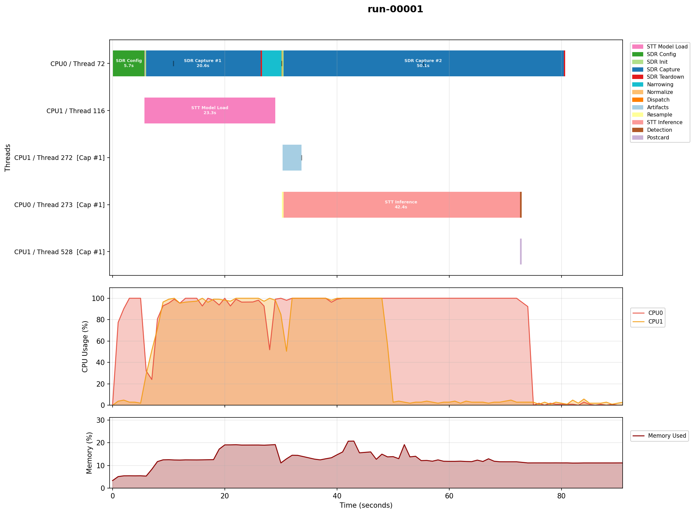

### Session 2 (clean pass)

Data from SMILE artifact [`pack-flatsat-4023_1787033754`](data/em-v8/pack-flatsat-4023_1787033754/). All 6 captures completed at full sample counts (20-21 s wall each), total 273.0 s against 280.1 s for the v7 run of the same schedule. Every capture transcribed noise fragments, detected nothing, and deleted its sc16 after its artifacts were generated: six `SC16 deleted` lines, six complete artifact sets, no `capture.sc16` anywhere in the pack, populated text files in all six captures, PSD comparison generated, clean `=== Done ===` exit, and no warnings or errors in the log. Received level at the quiet noise floor (I/Q RMS -53.4 dBFS; the v7 session's PRBS pollution was absent).

Neither session 1 anomaly reproduced. The capture 2 stall is a one-off of the IIO delivery path (untouched since v7), and the zero-byte text files point to the SMILE pack racing the force-exited session rather than failed writes.

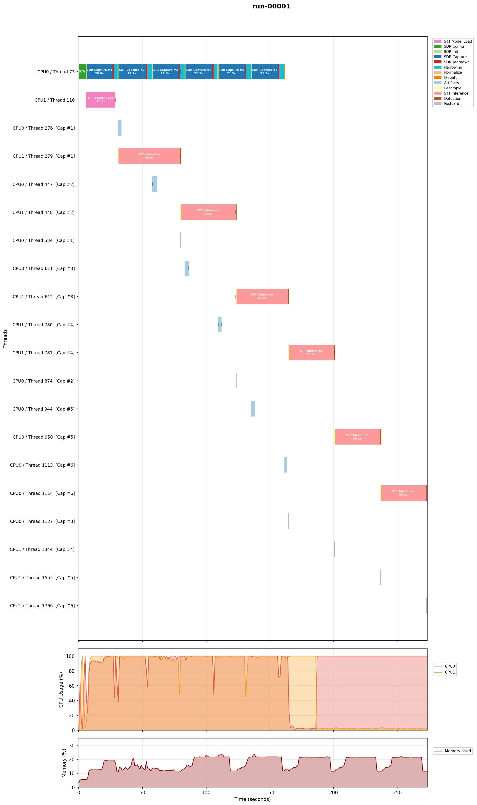

### Verdict

**v8 is verified on the EM and cleared for flight.** The detected-mode delete path executed seven times on hardware across the two sessions (config parse, the `should_keep_sc16` decision on a real capture, artifact-ordered deletion, audit logging). The keep path is accepted on ground validation: it is the same decision function short-circuiting before the delete, differing only in the early return and the `SC16 kept (command detected)` log line, and it is covered by the unit truth table and exercised end to end on the ground against flight-form FM voice input (see [V7_TO_V8.md](V7_TO_V8.md)).

## v7 Flight Package Verification

Data from SMILE artifact [`pack-4023_1784317832`](data/em-v7/pack-4023_1784317832/). The flight build of the v6-to-v7 patch (no replay file, `doom_force_trigger=false`, narrowing armed, hardware FIR) ran once via SMILE with the SDR on and nothing transmitted: the first live-SDR run of the v7 binary on the EM.

All 6 captures completed at full sample counts (4,000,000/4,000,000 I/Q, 320,000/320,000 audio each, 20-22 s wall), matching the v6 cadence. Narrowing ran on every capture; total 280.1 s against 270.0 s for the v6 run of the same capture schedule, about 1.7 s per 20 s capture. No command detected on any capture, sc16 deleted after diagnostics, no DOOM execution, service exit `status=127` as in all archived packs.

Observation: the received level was I/Q RMS -14.3 dBFS against -39.7 dBFS in the v6 run, and the PSD shows a stationary multi-lobed structure with deep nulls, identical across all six captures. The narrowing peak search reported -77 to -78 kHz on every capture, the strongest lobe. No false trigger resulted. Operations' likely explanation is a pseudorandom sequence generator left active from preceding Flatsat tests; its signal level and spectrum type match what was seen. This points to a ground test artifact rather than a property of the flight signal chain, and it did not affect the verification.

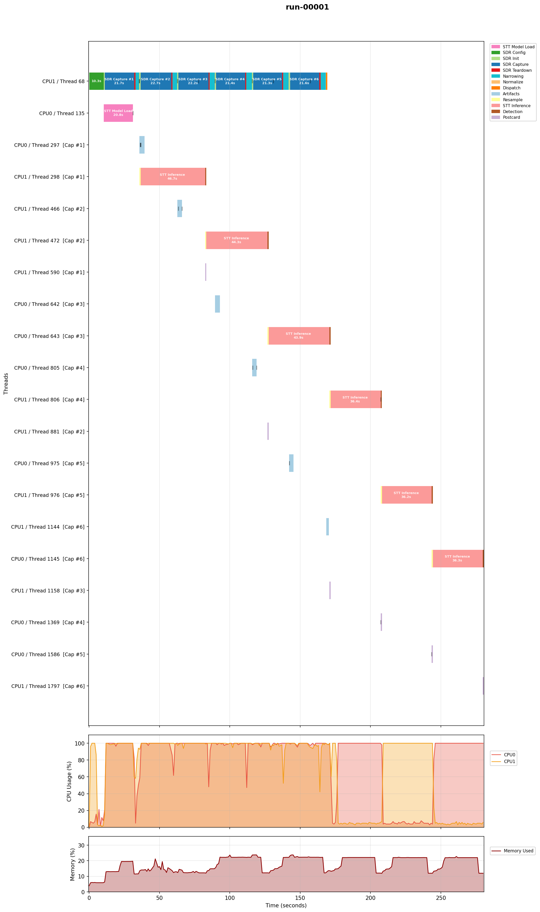

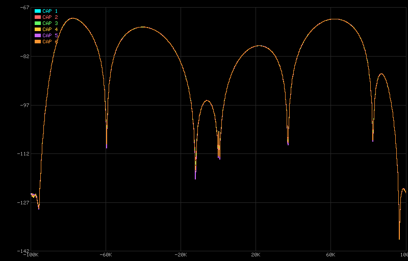

**With the replay validation below and this live-SDR run, v7 is verified on the EM and cleared for flight.**

## v7 Validation

Data from SMILE artifact [`pack-4023_1784280414`](data/em-v7/pack-4023_1784280414/). The `exp4023-pretty-DOOMed-v6-to-v7.tar.gz` patch (8.7 MB: `pretty-doomed`, `run`, `VERSION`, `config.cfg`, `input/replay.cs16`) was extracted over the intact v6 installation, models and libraries picked up in place. Single run via SMILE with the EM configuration (`doom_force_trigger=true`, narrowing armed); the `run` script detected `input/replay.cs16` (the Run 5 pass 2 recording `sdr_20260703_205825` in flight `capture.sc16` form, archived byte-identical as [data/em-v7/replay.cs16](data/em-v7/replay.cs16)) and replayed it instead of live capture, so the SDR stayed off.

The EM reproduced the ground reference (the QEMU dress rehearsal below, which ran the same package on the same input):

| Stage | EM result | Ground reference (QEMU) |
|---|---|---|
| Narrowing | peak at -8.27637 kHz, 0.5 s scan+regeneration for the 2 s capture | -8.27637 kHz, identical to the last logged digit |
| Normalization | rms=0.136517, scale=0.73251 | identical to the logged digit |
| Transcription | `LIMA OLFAR FOR VIGILIUM`, call sign token match (`LIMA`), 3.2 s inference | word-identical (the x86 build differs only in the noise tail: `LIMA ALPHAGIUM`) |
| Detection | no command (expected; the recording carries no command phrase) | identical |
| DOOM | force-triggered, `gl-e1m2b` completed (19.3 s) | identical demo |
| Postcard | 2520x1800, 9.2 s | identical |

Total 50.6 s, of which STT model load 18.8 s. This is the first on-hardware measurement of the v7 narrowing phase and it is negligible against the STT stages, as designed. The systemd `status=127` at service exit is identical in all archived EM packs back to April 2026 (pre-existing wrapper behavior, not v7).

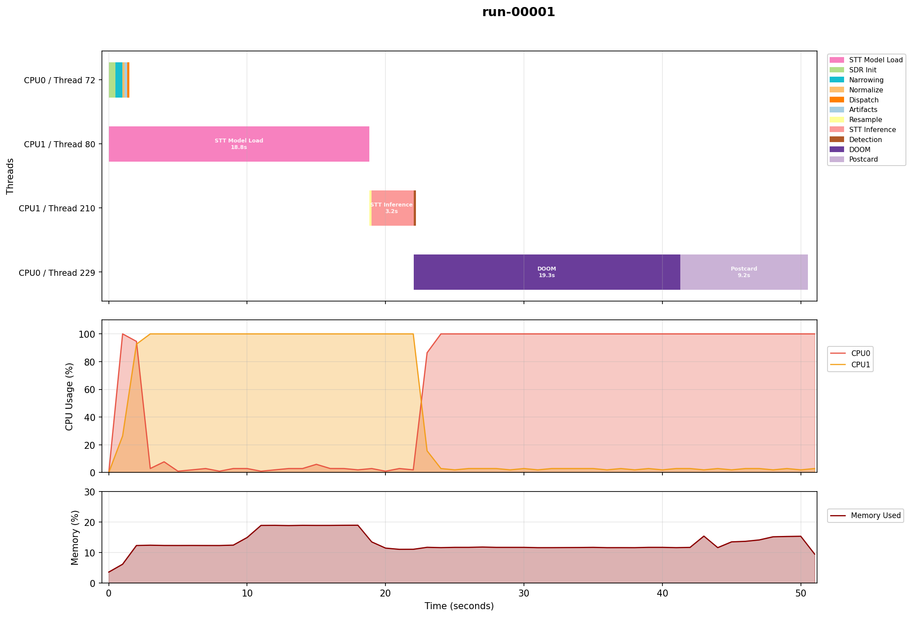

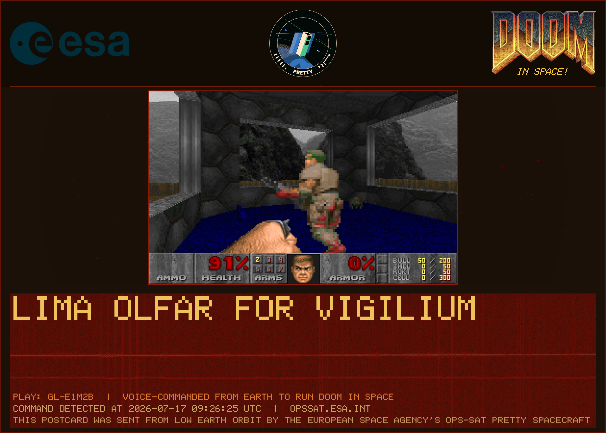

**Verdict: v7 is validated for flight.** The flight patch is the same build with `doom_force_trigger=false` and no `input/replay.cs16` (see the packaging section of [V6_TO_V7.md](V6_TO_V7.md)).

## v7 Local Validation (pre-EM)

Data in [data/local-v7/](data/local-v7/). This run was the ground dress rehearsal of exactly what the EM executed: the `exp4023-pretty-DOOMed-v6-to-v7.tar.gz` patch extracted over a v6-style installation (models and libraries provided by the existing deployment), run as-shipped via `./run` on the ARM32 binary, under QEMU user-mode emulation. The run was repeated against the archived v6 `libs/` exactly as deployed on the EM (the patch ships no libraries; see the packaging section of [V6_TO_V7.md](V6_TO_V7.md)) with identical results.

The package's `input/replay.cs16` (Run 5 pass 2 recording `sdr_20260703_205825`, converted to flight `capture.sc16` form) switched the run to sc16 replay mode automatically. Full sequence in 23.9 s:

| Stage | Result |
|---|---|
| Replay | `input/replay.cs16`, 2 s at 200 kHz effective |
| Narrowing | peak at -8.27637 kHz (injected -8 kHz plus Doppler residual), audio regenerated |
| Transcription | `LIMA OLFAR FOR VIGILIUM`, call sign token match (`LIMA`) |
| Detection | no command (expected; the recording carries no command phrase) |
| DOOM | force-triggered (`doom_force_trigger=true`), demo `gl-e1m2b` completed |
| Postcard | 2520x1800 generated from the replay's I/Q |

The narrowing peak is identical to the x86 reference run of the same input, and the transcription is in the same phonetic-alphabet family (the trailing words differ across runs because GNU Radio scheduling is not bit-deterministic, which shifts the beam search on the noise tail; the leading call-sign token is stable).

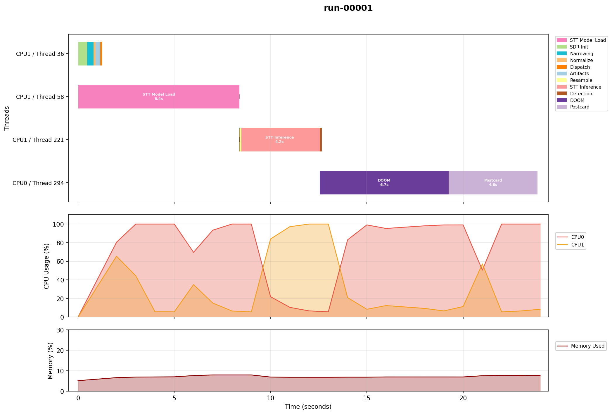

The timeline shows the first ARM32 measurement of the narrowing phase (teal, 0.35 s for a 2 s capture including the sc16 scan and audio regeneration, on QEMU-emulated cores; 0.5 s on the real EM). STT model load 8.4 s, inference 4.2 s, DOOM 6.7 s, postcard 4.6 s.

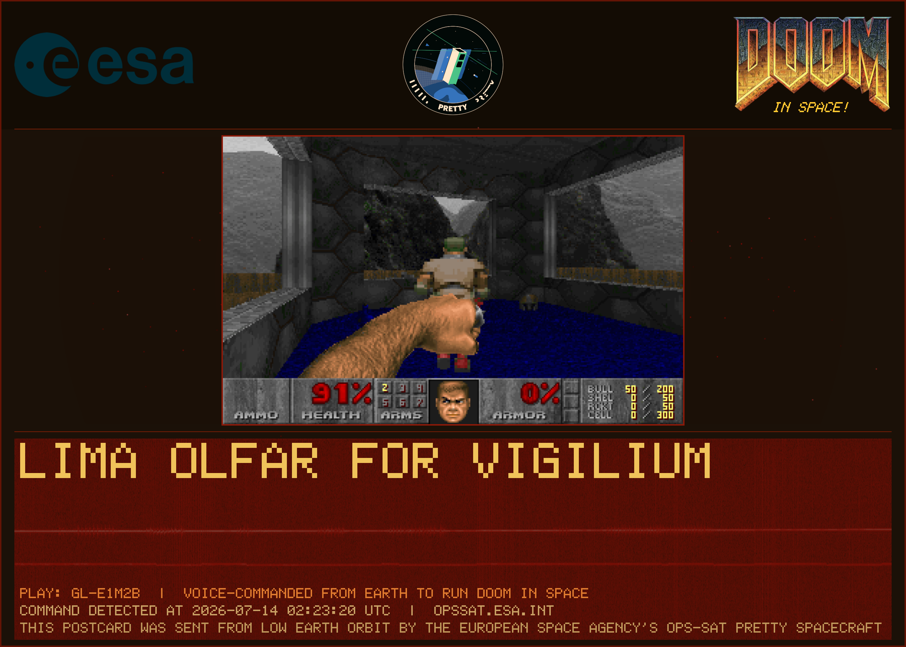

A second leg (live capture from the SDR emulator into the deployed package, exercising the IIO streaming path on ARM32) was attempted three times and each attempt died at a different point with the documented intermittent QEMU SIGFPE (see [TESTING.md](../TESTING.md)); the streaming flowgraph is unchanged since v6, was validated on the real EM then, and was validated end-to-end against the same emulator on x86 with the Run 5 replays. The live path will be confirmed on the real EM by leaving `input/replay.cs16` out, or on the next flight pass.

## v6 Validation

Data from SMILE artifact [`pack-4023_1775579267`](data/em-v6/pack-4023_1775579267/). The v6 patch fixed a postcard I/Q scatter rendering bug and simplified the run script for flight. The v6 EM run validated both execution paths:

- **Run 1** (3 x 20s, listen-only): all captures, diagnostics, and SC16 cleanup confirmed. Total: 147.3s.
- **Run 2** (3 x 20s, DOOM force-triggered): all 3 DOOM demos ran, postcards generated with smooth I/Q scatter (no stripes). Total: 164.9s.

Capture wall times (20-22s), STT inference (36-45s), and I/Q metrics are consistent with v5. Full v6 EM analysis in [changelog/V5_TO_V6.md](V5_TO_V6.md#v6-results).

## v6 Full Package Verification

Data from SMILE artifact [`pack-4023_1775661470`](data/em-v6/pack-4023_1775661470/). Full v6 SEPP package installed and run with the flight configuration: single run, 6 x 20s captures, `doom_force_trigger=false`.

All 6 captures completed successfully (20-21s each). No command detected (expected). STT inference: 47.0s, 42.3s, 37.2s, 36.2s, 36.0s, 36.2s. SC16 files deleted after diagnostics. Total: 270.0s (~4.5 min). I/Q metrics consistent with previous runs.

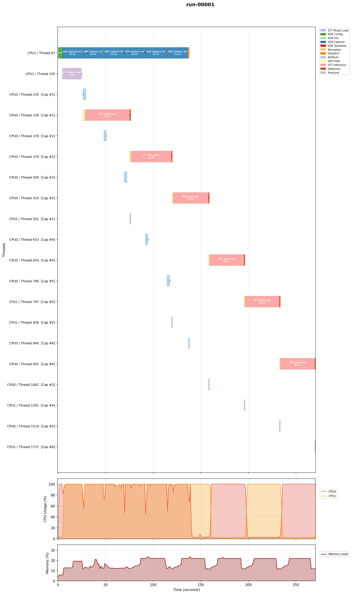

## v5 Detailed Results

Data from SMILE artifact [`pack-4023_1775155417`](data/em-v5/pack-4023_1775155417/).

## Run Configuration

| | Run 1 (sc16 preserved) | Run 2 (sc16 deleted) |
|---|---|---|
| Captures | 2 x 20s | 6 x 20s |
| sdr_keep_sc16 | true | false |
| Decimation | Hardware FIR (600 kSPS, 3x) | Hardware FIR (600 kSPS, 3x) |
| Process mode | background | background |
| sdr_init_per_capture | false (init once) | false (init once) |
| stt_concurrent_load | true | true |
| doom_force_trigger | true | true |

All runs: 1296 MHz, 200 kHz effective sample rate, 16 kHz audio output, sdr_timeout_multiplier=2.

## Timing Summary

### Run 1 (2 captures, sc16 preserved)

| Metric | Value |
|---|---|
| SDR Config (once) | 6.2s |
| Capture 1 wall time | 20s |
| Capture 2 wall time | 21s |
| STT 1 inference | 40.1s |
| STT 2 inference | 37.4s |
| LPF taps | 97 |
| **Total time** | **130.7s** |

### Run 2 (6 captures, sc16 deleted)

| Metric | Cap 1 | Cap 2 | Cap 3 | Cap 4 | Cap 5 | Cap 6 |
|---|---|---|---|---|---|---|
| Capture wall time | 20s | 20s | 20s | 23s | 23s | 22s |
| STT inference | 48.5s | 51.2s | 41.1s | 36.7s | 36.3s | 36.4s |

SDR Config (once): 4.4s. LPF taps: 97. **Total time: 295.0s.**

## Key Findings

### Once-per-run SDR init

The AD9361 configuration (FIR tap generation, clock chain, analog filter calibration) runs once before the capture loop. Run 2 shows a single 4.4s SDR Config phase, then 6 captures back-to-back with no re-initialization gaps. This saves ~26s compared to v4's per-capture init for 6 captures.

### Near-continuous capture

Captures 1-3 complete in 20s (matching configured duration). Captures 4-6 take 22-23s, likely due to CPU contention from concurrent STT inference. The flowgraph rebuild between captures takes ~17ms (not visible at this scale).

### Two-stage background processing

The STT chain processes captures sequentially (Transcriber is not thread-safe), while DOOM + Postcard fire async on separate threads. The timeline shows STT for capture N+1 starting immediately after STT for capture N completes, with DOOM/Postcard running concurrently.

STT times range from 36-51s. The first two captures (48.5s, 51.2s) are slower, likely due to concurrent SDR capture activity on the other core. Once all captures finish, STT times stabilize at 36-41s.

### sc16 cleanup

Run 2 confirms sc16 files are deleted after each capture's artifacts and postcard are generated. All 6 sc16 deletions logged. Run 1 confirms sc16 preservation with `sdr_keep_sc16=true`.

### Onboard diagnostics

All new v5 artifacts generated successfully for all captures:
- `capture-metrics.csv`: I/Q diagnostics (RMS, peak, PAPR, DC offset, imbalance, zero fraction)
- `capture-psd.csv` + `capture-psd.bmp`: PSD with 7811 Welch segments per capture
- `psd-comparison.bmp`: cross-capture PSD overlay (Run 2)
- Spectrogram and constellation BMPs with axis labels

### Downlink size

| | Uncompressed | tar.gz |
|---|---|---|
| Run 1 (2 captures, sc16 preserved) | 45 MB | ~26 MB |
| Run 2 (6 captures, sc16 deleted) | 33 MB | 23 MB |
| Full toGround (both runs) | 78 MB | 49 MB |

The 6-capture run without sc16 (23 MB compressed) is smaller than v4's 2-capture run with sc16 (~70 MB compressed).

## Run 1: 2 captures, sc16 preserved

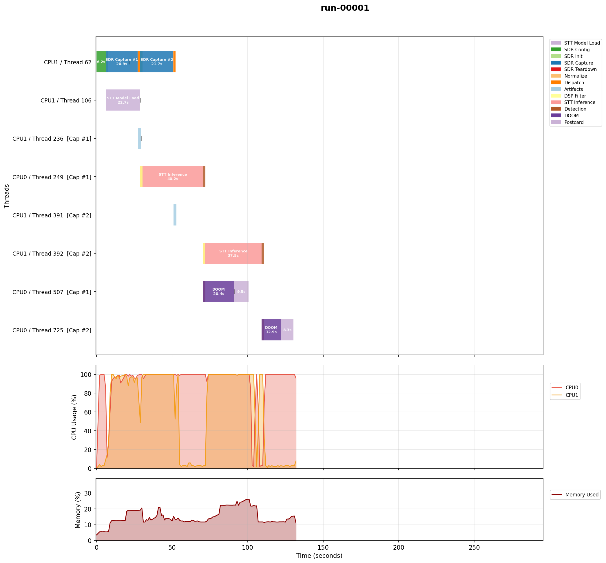

Two captures back-to-back. SDR Config (4.4s, teal) visible at start. Two-stage pipeline: STT 1 (40.2s) completes, DOOM 1 (20.4s) + Postcard fires async, STT 2 (37.5s) starts immediately. sc16 files preserved (used in postcard blood splatter overlay).

## Run 2: 6 captures, sc16 deleted

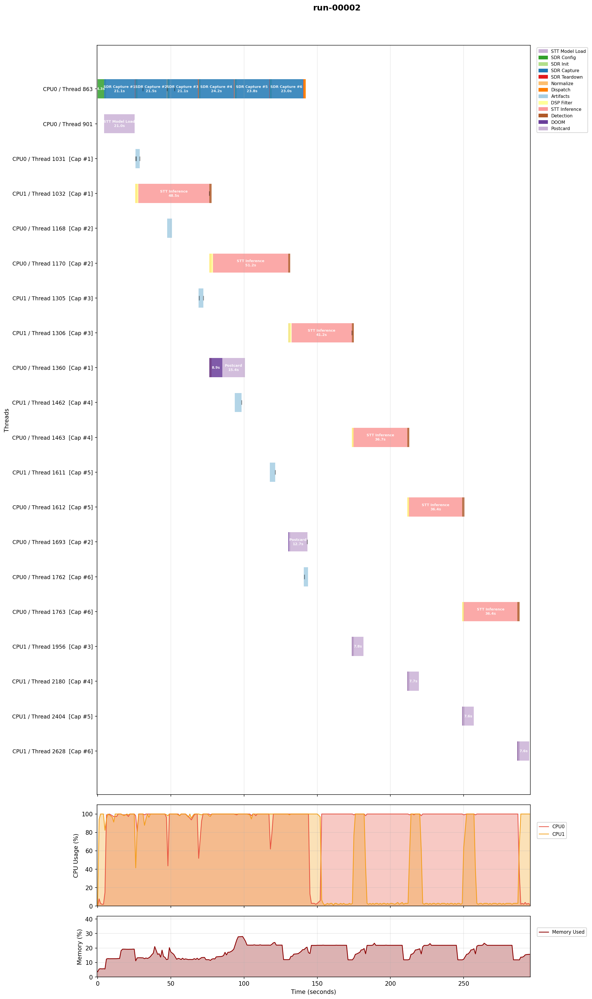

Six captures on the main thread, near-continuous. STT chain processes sequentially across background threads. DOOM + Postcard exec stages fire async after each STT completes. sc16 deleted after each capture's postcard is generated.

## Regenerating Plots

```bash
python3 scripts/plots/plot_resource.py --batch \
  --input-dir docs/changelog/data/em-v5/pack-4023_1775155417 \
  --output-dir docs/changelog/data/em-v5/pack-4023_1775155417
```

Requires `matplotlib` and `numpy` (`pip install matplotlib numpy`).

Source data: [changelog/data/em-v5/](data/em-v5/).
