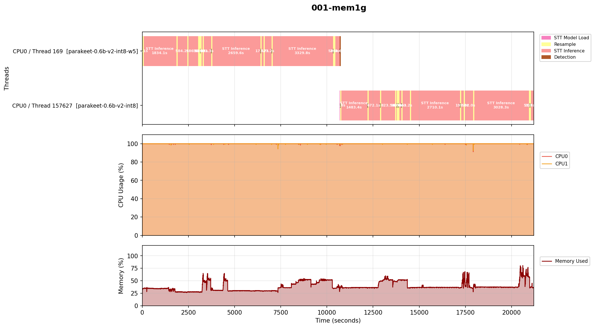
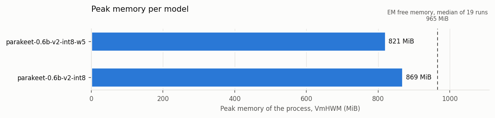
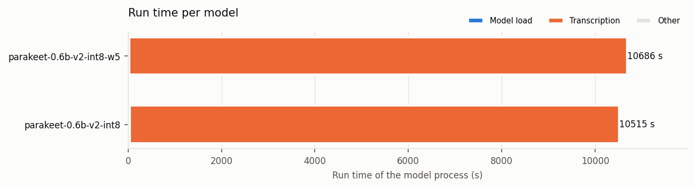
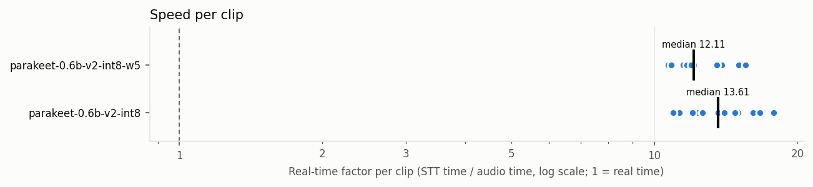
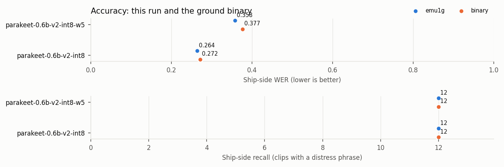

# Distress package v8-distress-1 on the SEPP emulator, 1 GB memory limit

Generated by `report.py` from `distress-00001`. Accuracy from `score.py` (`results/emu1g-<config>` against `results/binary-<config>`).

## Run

| Item | Value |
|---|---|
| Package version | 8-distress-1 |
| Start (UTC) | 2026-11-15 07:39:58 |
| End (UTC) | 2026-11-15 13:33:49 |
| Run time | 5.89 h |
| System | `Linux d34f8f8d0d7e 6.8.0-50-generic #51-Ubuntu SMP PREEMPT_DYNAMIC Sat Nov  9 18:03:35 UTC 2024 armv7l Linux` |
| MemTotal | 7925 MiB |
| Free memory at start (MemAvailable) | 6078 MiB |
| Lowest free memory during the run | 1536 MiB |
| Clips | 13, 830 s of audio |

## Resource use

The resource data is the same as for the DOOM runs: `resource.csv` has per-core CPU and memory every second. The peak memory is the VmHWM of the pretty-doomed process, from `stt.tsv`.

The reference free memory is the EM free memory, median of 19 runs, 965 MiB, measured by `mem_headroom.py` from the `resource.csv` files of those runs (`--free-from EM`). On the SEPP emulator, `resource.csv` shows the CPU and the memory of the Docker VM, with all of its containers, and not of the EM. Thus the CPU panel, the system memory line, MemTotal, and the free memory in the run table are not EM data. The thread timeline and the memory of the pretty-doomed process (`process.csv`) are valid. The process memory includes the memory of QEMU.

Thread timeline, per-core CPU, and memory (`plot_resource.py`, the figure of the DOOM runs). Each model runs in its own process. Each thread row has the name of its model: the main thread transcribes the clips, and the report card thread draws the cards while the next clip is transcribed. The memory panel has the system memory (`resource.csv`) and the memory of the pretty-doomed process (`process.csv`).

| Model | Exit | Run time | Model load | Peak memory (VmHWM) | Margin to EM free memory, median of 19 runs (965 MiB) | Lowest free memory |
|---|---|---|---|---|---|---|
| `parakeet-0.6b-v2-int8-w5` | 0 | 178 min | 23.1 s | 821 MiB | 144 MiB | 2773 MiB |
| `parakeet-0.6b-v2-int8` | 0 | 175 min | 31.8 s | 869 MiB | 96 MiB | 1536 MiB |

## Speed

Run time of each model process: model load, transcription of all the clips, and the rest (report cards after the last clip, detection, model release, and exit).

| Model | Window | Decoding | Clips | Audio | STT time | Median RTF | Highest RTF |
|---|---|---|---|---|---|---|---|
| `parakeet-0.6b-v2-int8-w5` | 5 s | greedy_search | 13 | 830 s | 178 min | 12.11 | 15.56 |
| `parakeet-0.6b-v2-int8` | 10 s | greedy_search | 13 | 830 s | 175 min | 13.61 | 17.80 |

## Accuracy

Ship-side WER uses the VESSEL and OTHER turns. Recall is the number of clips with a distress phrase in the ship-side speech. The scoring rules are in `tools/distress/README.md`.

Scored on the 13 clip(s) of this run, for this run and for `binary` alike.

| Model | WER, ship-side (emu1g) | WER, ship-side (binary) | Recall (emu1g) | Recall (binary) | Phrases, ship-side (emu1g) |
|---|---|---|---|---|---|
| `parakeet-0.6b-v2-int8-w5` | 0.358 | 0.377 | 12/13 | 12/13 | fire, going down, grounded, help, listing, mayday, sinking, taking on water |
| `parakeet-0.6b-v2-int8` | 0.264 | 0.272 | 12/13 | 12/13 | fire, going down, grounded, help, mayday, sinking, taking on water |

## Per clip

Real-time factor and on-board detection (`detected` in `timing.tsv`). The on-board detection accepts one approximate match, so it is for information only. The ground scorer gives the recall.

| Clip | Audio | `parakeet-0.6b-v2-int8-w5` | `parakeet-0.6b-v2-int8` |
|---|---|---|---|
| 34749-imagination | 131 s | 13.96, yes | 11.29, no |
| 35098-midnite-sun-relay | 55 s | 10.67, yes | 12.28, yes |
| 35135-double-time | 51 s | 11.50, yes | 16.15, yes |
| 35628-miss-yalanda | 5 s | 10.84, yes | 17.80, yes |
| 37977-bainbridge-skiff | 4 s | 12.13, yes | 15.00, yes |
| 41096-kupreanof | 11 s | 11.85, yes | 16.68, yes |
| 44865-galveston-capsize | 31 s | 15.03, yes | 14.78, yes |
| 46250-star-king | 227 s | 11.70, yes | 11.93, yes |
| 46887-surfside-fire | 15 s | 12.11, yes | 13.61, yes |
| 48097-oahu-sailboat | 36 s | 11.94, yes | 14.03, yes |
| 53901-captain-billy-haver | 240 s | 13.87, yes | 12.61, yes |
| 56367-netarts-pwc | 4 s | 13.52, yes | 12.01, yes |
| 87205-molokai | 19 s | 15.56, yes | 10.94, yes |
