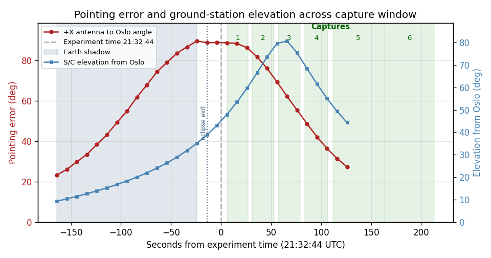
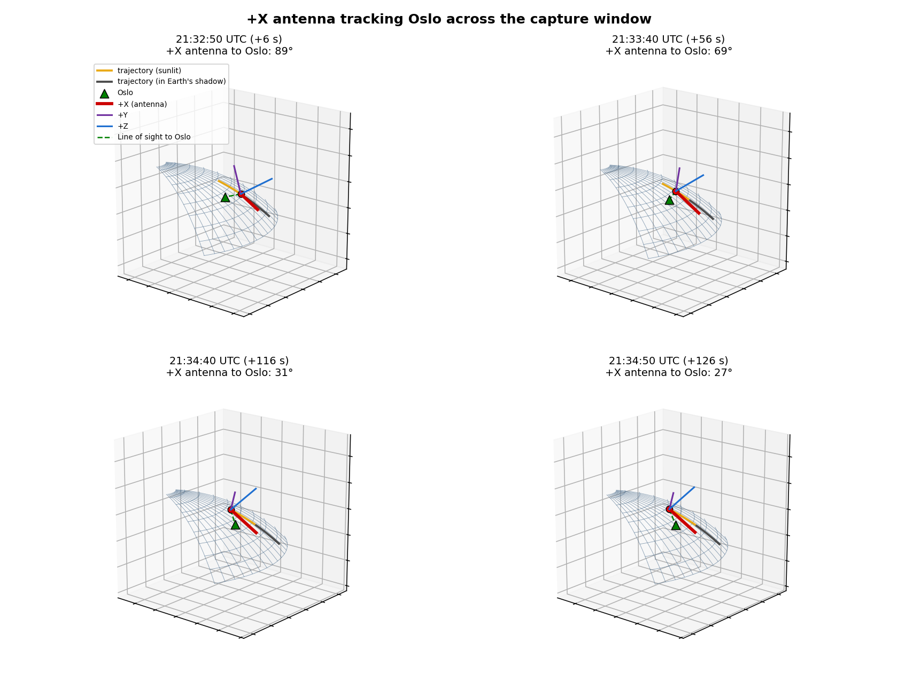
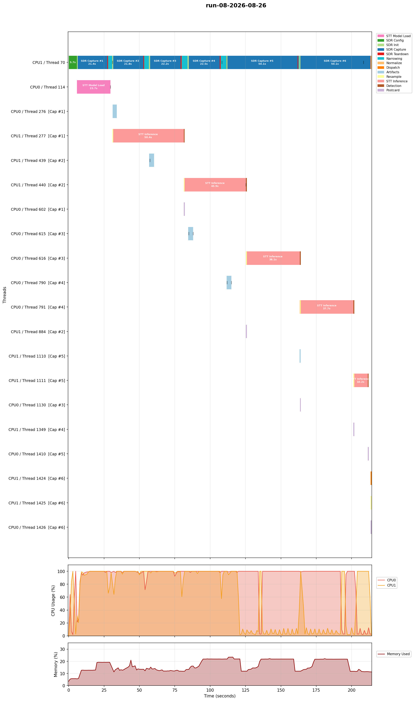

# Flight analysis debriefing: Run 8 (2026-08-26, evening pass)

Run 8 is the first coordinated pass with v8 on board, and the first flight attempt since the July campaign that produced the [Run 6](../run-06-2026-07-27/) and [Run 7](../run-07-2026-07-27/) detections. It did not detect. Operations reported that the experiment was started with an incorrect script, which pointed the spacecraft at the wrong location during the acquisition, and the attitude telemetry TUG supplied confirms that directly. Two further findings come out of the data: the narrowing peak search locked onto a near-stationary spectral feature rather than the uplink, and the SDR sample-delivery stall that cost Run 7 its last two captures returned on the same two capture indices.

## What happened

The app started at 2026-08-26T21:32:44Z. Six 20 s captures were configured; four completed, one was partial, one was empty, and the run finished in 213.7 s with a clean shutdown. No capture detected the command and `doom_force_trigger` was false, so no DOOM ran. All six raw I/Q files were deleted on board by the v8 retention policy, which was working as designed given the absence of detections.

| Capture | RMS I (dBFS) | Narrowing peak | Transcript | Result |
|---|---|---|---|---|
| 1 | -46.46 | +16.02 kHz | `AND SO` | no |
| 2 | -46.79 | +14.65 kHz | `TO HIM` | no |
| 3 | -47.82 | +12.72 kHz | `AND SOULS` | no |
| 4 | -46.22 | +13.04 kHz | `TOO` | no |
| 5 | -46.58 | +12.79 kHz | `AMIS` | no (partial capture) |
| 6 | -- | narrowing failed | none | no (empty capture) |

## Pointing

The pass geometry was excellent and the attitude was not. Spacecraft elevation from Oslo was 43 deg at app start and peaked near 80 deg during capture 3, at a slant range of 706 km, which is about as favourable as this campaign has seen. The +X antenna boresight error to Oslo, computed from the 31 UKF samples TUG supplied and a TLE of epoch 2026-09-02, was 88.85 deg at app start: the antenna was pointing very nearly perpendicular to the ground station.

The shape of the error curve is the tell. The error climbs from 23 deg at -165 s to its 88.85 deg maximum right at app start, then falls steadily to 27 deg by the end of telemetry at +126 s. A correctly commanded pass minimises boresight error across the capture windows; this profile maximises it at the moment the captures begin. That is consistent with the incorrect script operations reported, and it is not a small miss. For comparison, Run 6 detected the command with 9 to 24 deg of error and Run 3 missed with 3 to 11 deg.

Attitude telemetry ends at 21:34:50Z, inside capture 5, so the two degraded captures at the end of the run are only partly covered. The best pointing of the whole run, around 27 deg, coincides with those captures, which is a nuisance: the run was mispointed while the SDR was healthy and better pointed once it was not.

## The narrowing peak was not the uplink

The narrowing peak search reported a coherent, slowly moving peak in every capture, between +12.72 and +16.02 kHz. That looked at first like a candidate for the Oslo carrier received weakly through the mispointed antenna, which would have been a useful result about link margin. Testing it against the pass geometry rules it out.

A ground transmitter seen from this pass produces a large Doppler sweep. Predicted from the TLE and the Oslo target, the shift runs from +17.8 kHz during capture 1 through zero near capture 3, where the pass peaks in elevation, to -23.5 kHz by capture 5, a swing of 41 kHz. The observed peak moves 3.3 kHz in total and never changes sign, so the residual against prediction grows monotonically from -1.8 kHz to +36.3 kHz.

| Capture | Predicted Doppler | Observed peak | Residual |
|---|---|---|---|
| 1 | +17.82 kHz | +16.02 kHz | -1.80 kHz |
| 2 | +9.16 kHz | +14.65 kHz | +5.49 kHz |
| 3 | -2.57 kHz | +12.72 kHz | +15.29 kHz |
| 4 | -13.89 kHz | +13.04 kHz | +26.92 kHz |
| 5 | -23.52 kHz | +12.79 kHz | +36.31 kHz |

Whatever the peak search found sits at a nearly fixed baseband offset and does not track the sky, so it is internal to the receive chain rather than received from the ground. This is the same reasoning that made [Run 5](../run-05-2026-07-03/) conclusive, applied in reverse: there, a signal drifting at the pass Doppler rate proved external origin, and here the absence of that drift proves the opposite.

The engineering consequence matters more than the diagnosis. The peak search guards the AD9361 DC spike with a 2 kHz exclusion, but nothing protects it from a strong feature elsewhere in the search band. On this pass there was no uplink to lose, so locking onto a spur at +13 kHz cost nothing. On a correctly pointed pass, a spur that outranks the uplink would send the narrowing stage to the wrong part of the spectrum and the voice would be lost in a stage that is supposed to recover it. Runs 6 and 7 detected with narrowing armed, so the spur either was not present or did not dominate then. Worth resolving before the next coordinated pass: confirm whether the feature is persistent, and if it is, consider excluding known spur offsets or preferring a peak that Doppler-tracks across captures.

## SDR sample stall

Captures 1 to 4 delivered full sample counts at about 21 s wall. Capture 5 stopped receiving at 1,179,648 of 4,000,000 samples, roughly 5.9 s of data, froze there from the 15 s mark, and was held to the 50 s timeout. Capture 6 received nothing at all, 0 of 4,000,000, and its sc16 was written header-only.

Run 7 lost the same two capture indices with the same partial-then-empty shape, capture 5 stopping at 808,277 samples there against 1,179,648 here. The same stall also occurred once on the engineering model during v8 verification, on capture 2. Two flight occurrences on the same indices point to degradation that accumulates across a six-capture session rather than a random fault, and the sample delivery path is untouched between v7 and v8, so this is not a software regression. `sdr_init_per_capture=true`, which re-initialises the AD9361 before each capture, is the untried mitigation.

The pipeline degraded gracefully, as in Run 7. Capture 5's partial 5.9 s went through narrowing and transcribed in 10.2 s, capture 6 produced the expected warnings for an empty file, both had their sc16 deleted normally, and the run shut down cleanly with no crash and no force-exit.

## What it means

The pass was lost to the pointing error, and the cause is understood and external to the experiment. Nothing in the flight software misbehaved: the capture chain, the retention policy, the artifact generation, and the error handling around a dead SDR all did what they should, and v8's detection-conditional retention made its first coordinated-pass appearance without incident.

Two items carry forward to the next attempt. The stall is now a repeating flight behaviour rather than an oddity, and it lands late in a six-capture run, so it threatens whichever capture happens to be last; robust-mode init is the obvious thing to try. The spur that captured the narrowing peak search is the newer concern, because it is a way to lose a detection on a pass that is otherwise perfect. Neither is a reason to change the flight software before the next pass, but both deserve a decision.

The full downlinked artifacts are in [`../../data/run-08-2026-08-26/`](../../data/run-08-2026-08-26/).
