# Distress detection on the EM: first test, two clips

Generated by `report.py` from `distress-00001`. Accuracy from `score.py` (`results/em-<config>` against `results/binary-<config>`).

## Run

| Item | Value |
|---|---|
| Package version | 8-distress-v1 |
| Start (UTC) | 2026-11-18 19:25:11 |
| End (UTC) | 2026-11-18 19:32:21 |
| Run time | 0.11 h |
| System | `Linux exp-4023 4.9.0 #7 SMP Fri Nov 12 13:21:34 UTC 2021 armv7l Linux` |
| MemTotal | 1003 MiB |
| Free memory at start (MemAvailable) | 967 MiB |
| Lowest free memory during the run | 256 MiB |
| Clips | 2, 9 s of audio |

## Resource use

The resource data is the same as for the DOOM runs: `resource.csv` has per-core CPU and memory every second. The peak memory is the VmHWM of the pretty-doomed process, from `stt.tsv`.

Thread timeline, per-core CPU, and memory (`plot_resource.py`, the figure of the DOOM runs). Each config runs in its own process. Each thread row has the name of its config: the main thread transcribes the clips, and the report card thread draws the cards while the next clip is transcribed. The memory panel has the system memory (`resource.csv`) and the memory of the pretty-doomed process (`process.csv`).

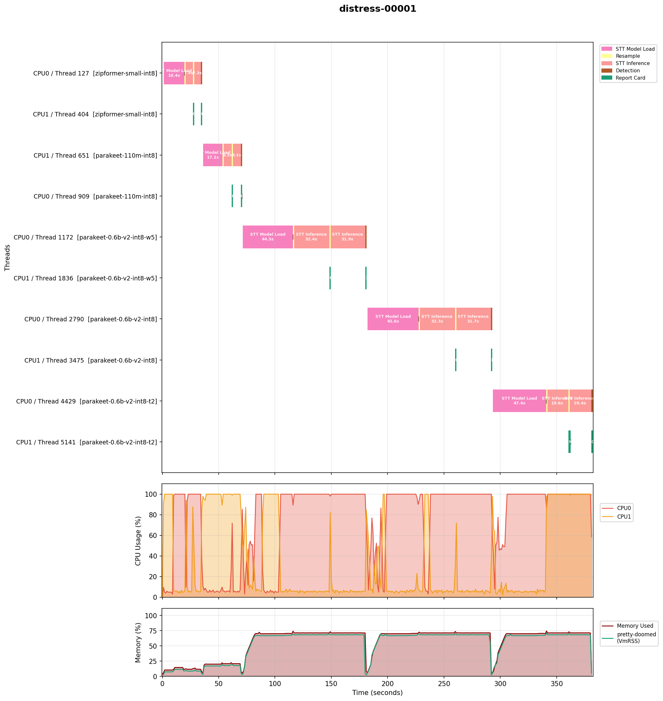

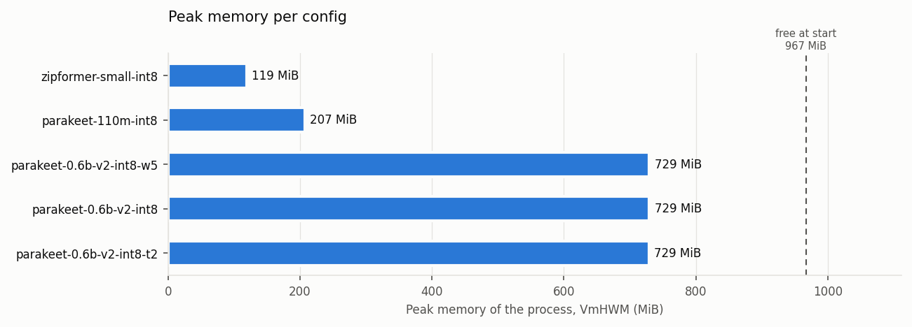

| Config | Exit | Run time | Model load | Peak memory (VmHWM) | Margin to free at start (967 MiB) | Lowest free memory |
|---|---|---|---|---|---|---|
| `zipformer-small-int8` | 0 | 35 s | 18.4 s | 119 MiB | 848 MiB | 857 MiB |
| `parakeet-110m-int8` | 0 | 35 s | 17.1 s | 207 MiB | 760 MiB | 778 MiB |
| `parakeet-0.6b-v2-int8-w5` | 0 | 111 s | 44.5 s | 729 MiB | 238 MiB | 259 MiB |
| `parakeet-0.6b-v2-int8` | 0 | 112 s | 45.6 s | 729 MiB | 238 MiB | 264 MiB |
| `parakeet-0.6b-v2-int8-t2` | 0 | 89 s | 47.4 s | 729 MiB | 238 MiB | 256 MiB |

## Report cards made on board

One PNG per clip and config, drawn by the pretty-doomed binary on board (`report_card=true`). 10 cards below, by clip, in `report_cards/<clip>/<config>.png`.

| Config | Cards | Card time, median |
|---|---|---|
| `zipformer-small-int8` | 2 | 992 ms |
| `parakeet-110m-int8` | 2 | 1017 ms |
| `parakeet-0.6b-v2-int8-w5` | 2 | 1042 ms |
| `parakeet-0.6b-v2-int8` | 2 | 1044 ms |
| `parakeet-0.6b-v2-int8-t2` | 2 | 1432 ms |

### 37977-bainbridge-skiff

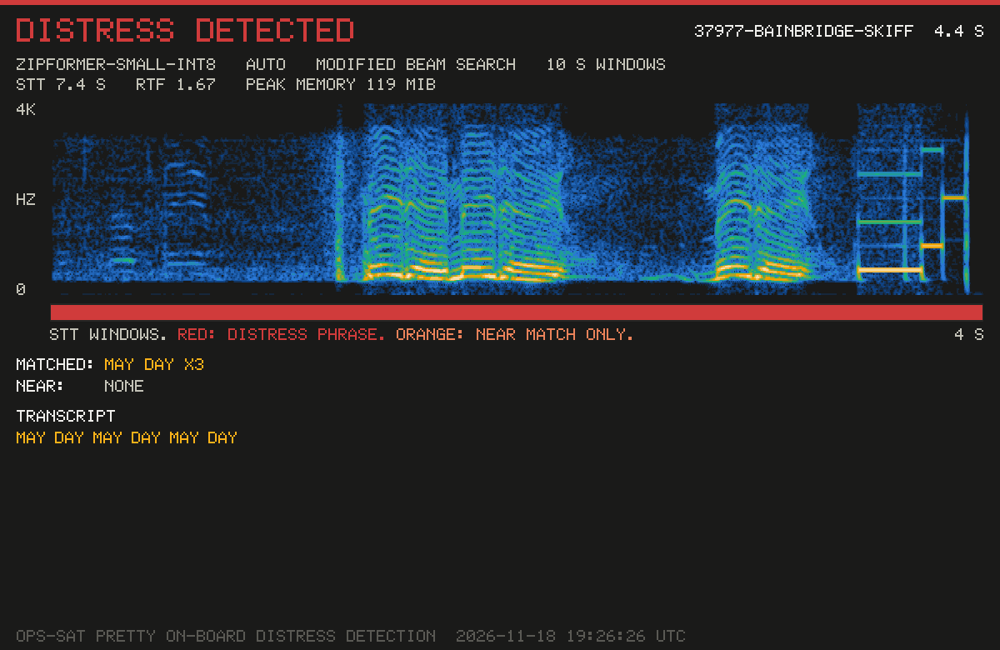

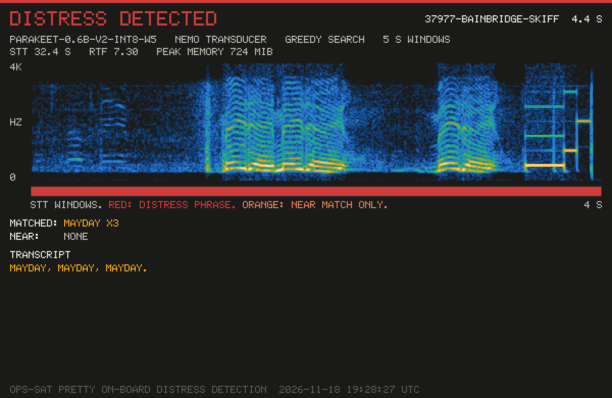

### 56367-netarts-pwc

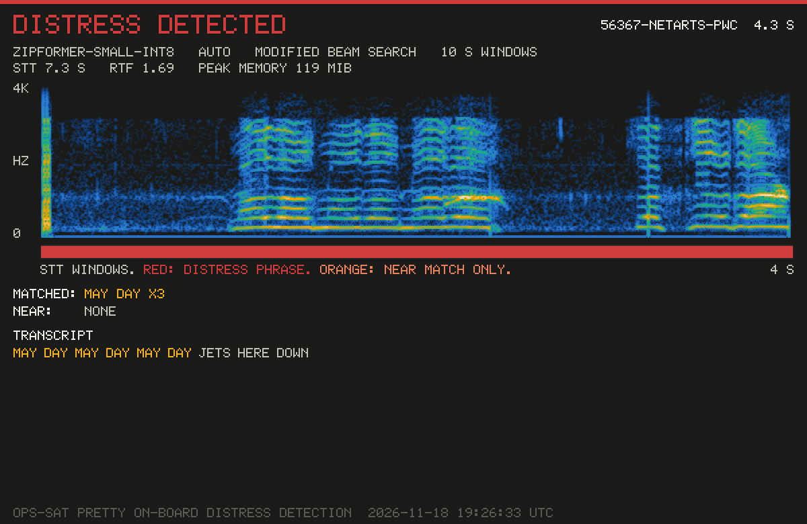

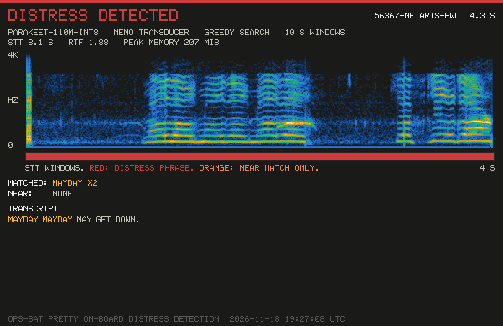

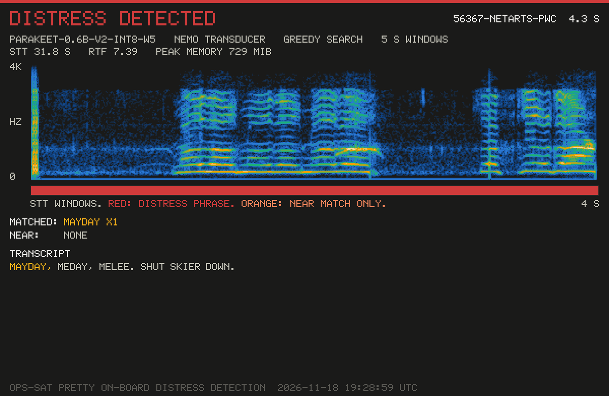

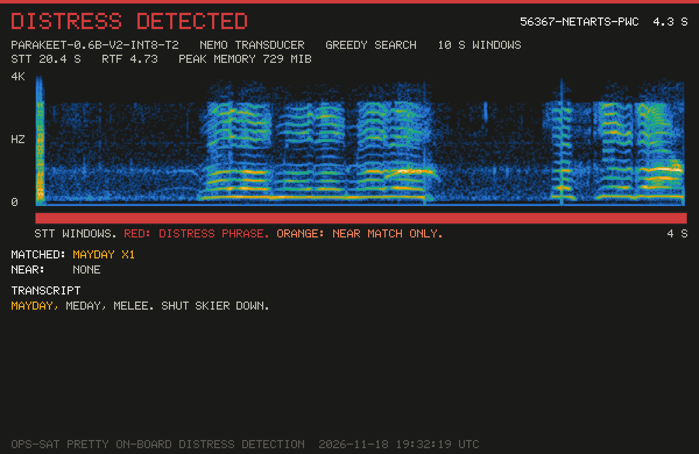

## Speed

Run time of each config process: model load, transcription of all the clips, and the rest (report cards after the last clip, detection, model release, and exit).

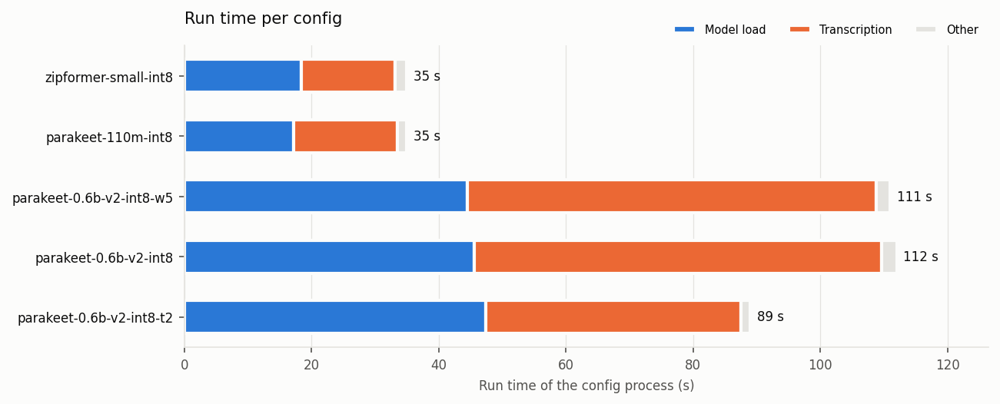

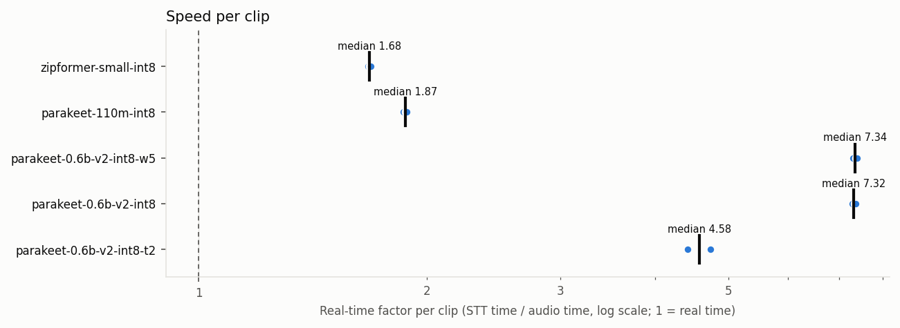

| Config | Window | Decoding | Clips | Audio | STT time | Median RTF | Highest RTF |
|---|---|---|---|---|---|---|---|
| `zipformer-small-int8` | 10 s | modified_beam_search | 2 | 9 s | 15 s | 1.68 | 1.69 |
| `parakeet-110m-int8` | 10 s | greedy_search | 2 | 9 s | 16 s | 1.87 | 1.88 |
| `parakeet-0.6b-v2-int8-w5` | 5 s | greedy_search | 2 | 9 s | 64 s | 7.34 | 7.39 |
| `parakeet-0.6b-v2-int8` | 10 s | greedy_search | 2 | 9 s | 64 s | 7.32 | 7.36 |
| `parakeet-0.6b-v2-int8-t2` | 10 s | greedy_search | 2 | 9 s | 40 s | 4.58 | 4.73 |

## Accuracy

Ship-side WER uses the VESSEL and OTHER turns. Recall is the number of clips with a distress phrase in the ship-side speech. The scoring rules are in `tools/distress/README.md`.

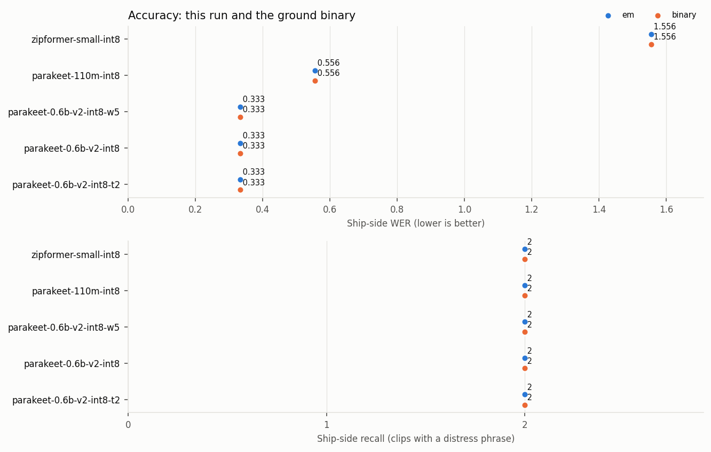

Scored on the 2 clip(s) of this run, for this run and for `binary` alike.

| Config | WER, ship-side (em) | WER, ship-side (binary) | Recall (em) | Recall (binary) | Phrases, ship-side (em) |
|---|---|---|---|---|---|
| `zipformer-small-int8` | 1.556 | 1.556 | 2/2 | 2/2 | mayday |
| `parakeet-110m-int8` | 0.556 | 0.556 | 2/2 | 2/2 | mayday |
| `parakeet-0.6b-v2-int8-w5` | 0.333 | 0.333 | 2/2 | 2/2 | mayday |
| `parakeet-0.6b-v2-int8` | 0.333 | 0.333 | 2/2 | 2/2 | mayday |
| `parakeet-0.6b-v2-int8-t2` | 0.333 | 0.333 | 2/2 | 2/2 | mayday |

## Per clip

Real-time factor and on-board detection (`detected` in `timing.tsv`). The on-board detection accepts one approximate match, so it is for information only. The ground scorer gives the recall.

| Clip | Audio | `zipformer-small-int8` | `parakeet-110m-int8` | `parakeet-0.6b-v2-int8-w5` | `parakeet-0.6b-v2-int8` | `parakeet-0.6b-v2-int8-t2` |
|---|---|---|---|---|---|---|
| 37977-bainbridge-skiff | 4 s | 1.67, yes | 1.86, yes | 7.30, yes | 7.28, yes | 4.42, yes |
| 56367-netarts-pwc | 4 s | 1.69, yes | 1.88, yes | 7.39, yes | 7.36, yes | 4.73, yes |
